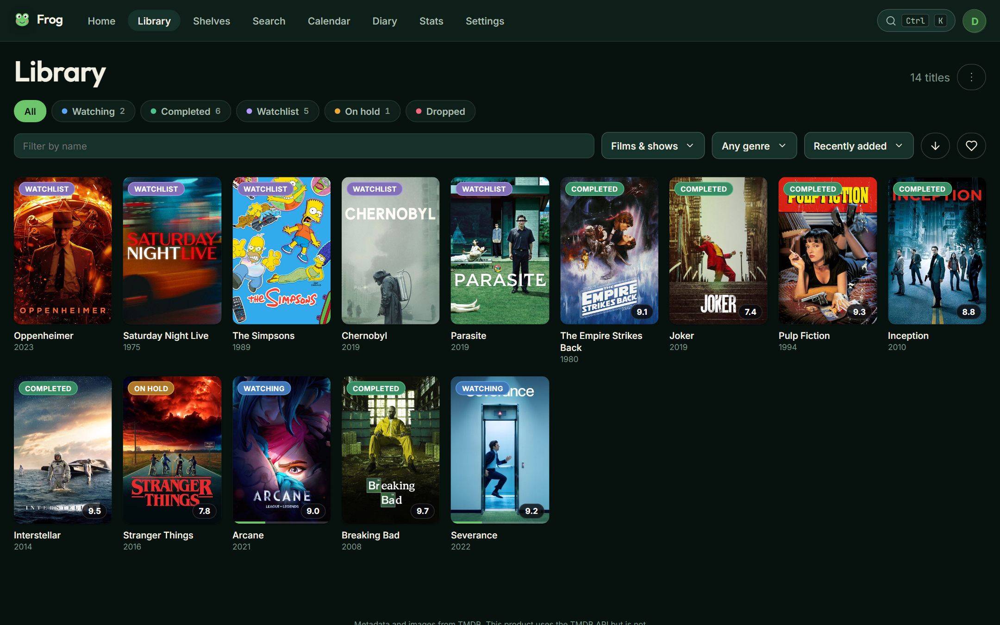
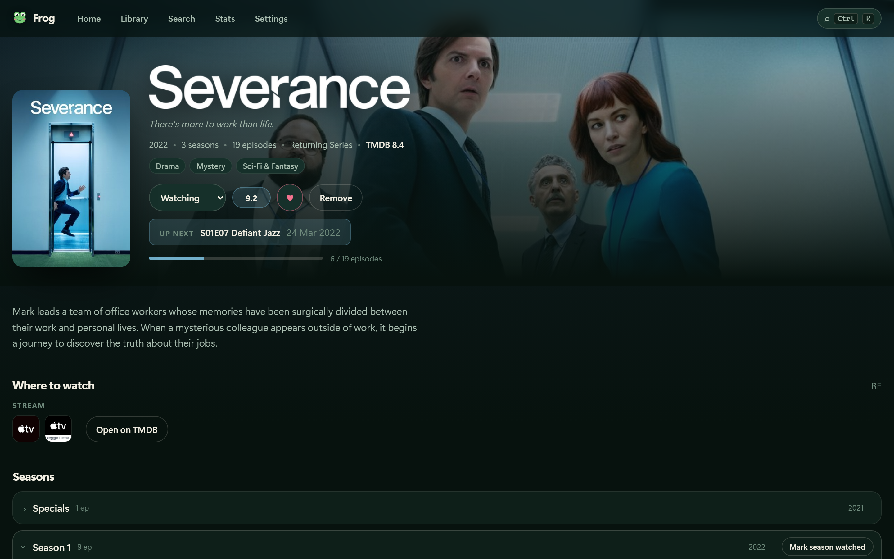
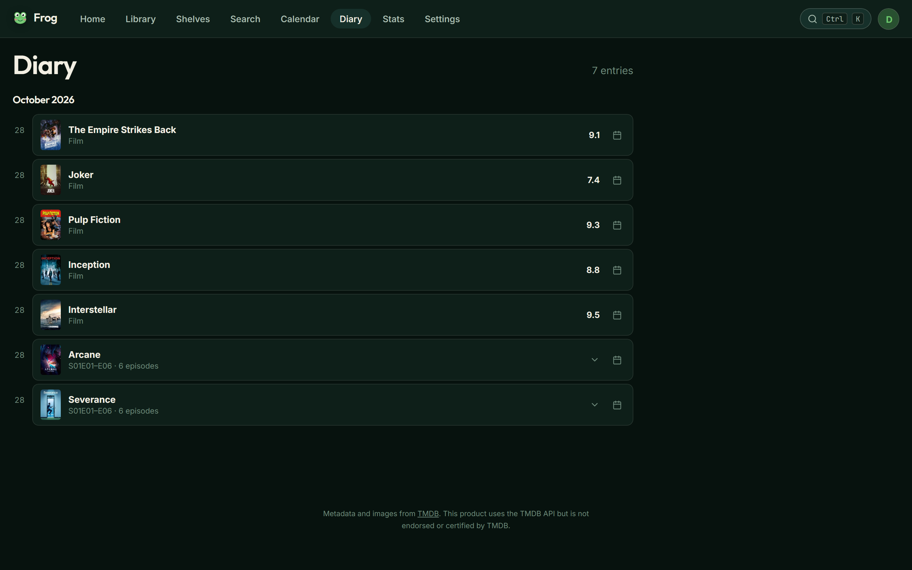
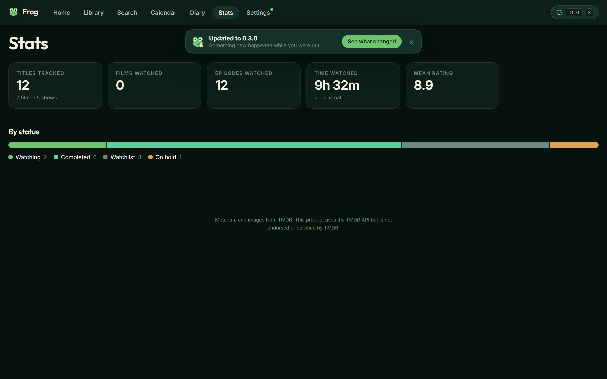
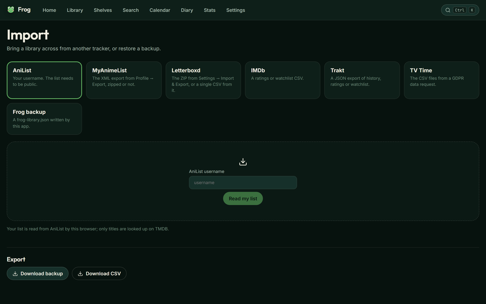
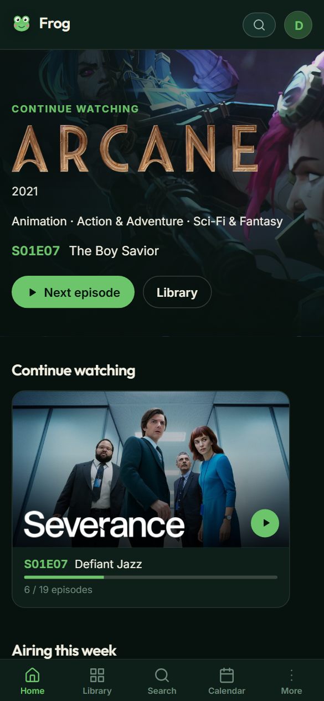
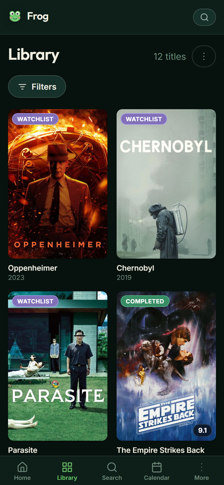
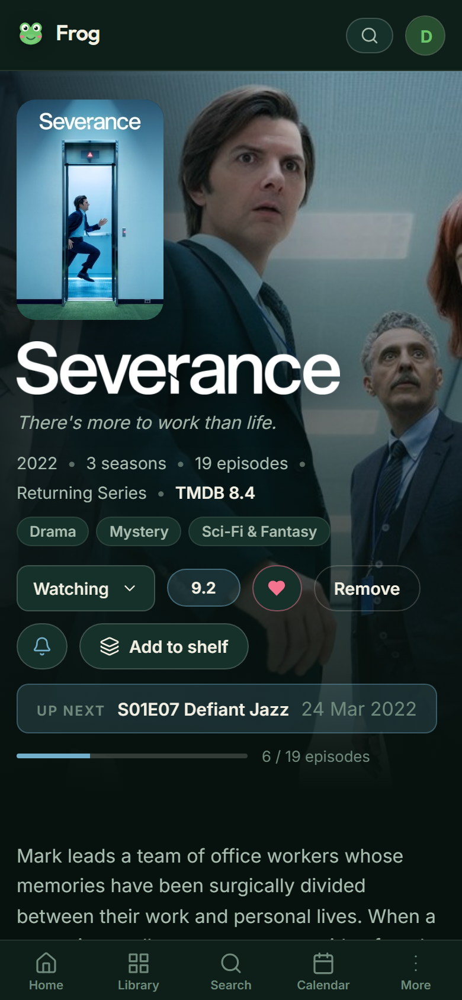
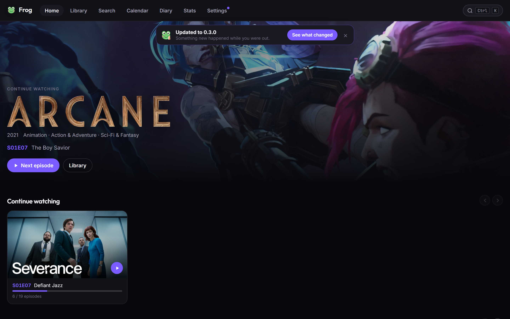
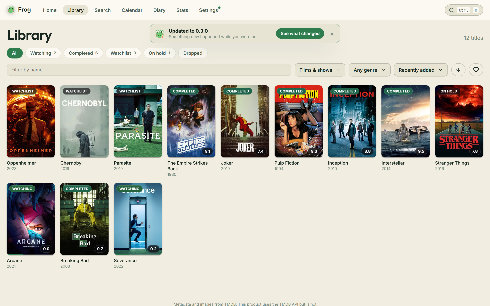

# Frog

### Your own little cinema, on your own little computer.

Frog remembers every film and show you watch, and gives them a beautiful place
to live. It runs on your laptop, your phone reaches it privately, and it costs
nothing at all.

[**Get started →**](docs/INSTALL.md)
&nbsp;·&nbsp;
[What's new](RELEASE-NOTES.md)
&nbsp;·&nbsp;
[How it works](ARCHITECTURE.md)

 

---

## What it looks like

<table>
<tr>
<td width="50%">

<b>Your library</b> Every poster, filtered and sorted however you like

</td>
<td width="50%">

<b>A title page</b> Coloured by its own poster, down to the buttons

</td>
</tr>
<tr>
<td>

<b>Your diary</b> Everything you have watched, newest first

</td>
<td>

<b>Your numbers</b> Years, genres, streaks, and a card to share

</td>
</tr>
<tr>
<td>

<b>Make it yours</b> Themes, fonts, shapes, cards and rows — all live

</td>
<td>

<b>Bring your history</b> Letterboxd, Trakt, IMDb, TV Time, AniList and MyAnimeList

</td>
</tr>
</table>

### On a phone

&nbsp;&nbsp;

&nbsp;&nbsp;

Add it to your home screen and it behaves like any other app.

  

### Four themes, or build your own

&nbsp;

Pond, Pond Light, Dark and AMOLED — or pick every colour yourself.

---

## A quick tour

**Bring your history with you.** Import from Letterboxd, Trakt, IMDb, TV Time,
AniList or MyAnimeList. Frog reads the export, matches each title, shows you
what it found and lets you correct anything it got wrong before a single row is
written. Anime seasons land on the right season, parts and all.

**Find anything.** Search every film and show on TMDB and add it with one tap.
Results lead with the thing you actually meant, rather than obscure shorts that
happen to share a word.

**Tick episodes off.** There is a circle beside every episode. Tap it and the
show moves itself to Watching; tick the last one and it completes itself. Rate
episodes one by one, leave notes on them, and see a whole series at a glance as
a grid of coloured squares.

**Know what is next.** Home opens on whatever you are in the middle of and
names the exact next episode. The calendar shows the month ahead, and the diary
reads back everything you have watched.

**Hear about it the day it lands.** Turn on notifications and Frog tells you
when a show you follow has a new episode out. Mute any show with the bell on
its page.

**See your year.** Time watched, streaks, genres, decades, how you rate, and
the actors, directors and studios you watch most — for all time or for any
year. Turn a year into a card you can share from your phone.

**Build shelves.** Hand-pick titles into shelves and drag them into the order
you want, or write a rule and let a shelf fill itself — shows in progress rated
8 or more, say.

**Press Ctrl+K.** Jump to any title, page or setting without reaching for the
mouse.

**Rate it your way.** Out of 100, out of 10, out of 10 with a decimal, five
stars, or three smileys. Switch whenever you like: the number underneath never
changes, so nothing is ever rounded away.

**Make it look how you want.** Four themes plus a colour editor, six fonts, text
size, corner radius, how much glass blur, how much animation, four card styles,
poster size, what appears on a card, which rows show on Home and in what order,
and a box for your own CSS if none of that is enough. Export the lot as a file.

**Keep spoilers out.** Blur the still for anything you have not watched yet.

**Take it with you.** Install it on your phone. Anything you have already opened
keeps working when you have no signal.

---

## Why Frog?

- **It is yours.** The whole database is one file on your own disk. No account
  on someone else's computer, nothing that can be discontinued.
- **It is free, genuinely.** No subscription, no paid tier, no API that starts
  charging later. The only thing it needs is a free TMDB key.
- **It is quiet.** No ads, no tracking, no analytics, no telemetry, no emails.
- **It is fast.** Everything you have looked at once is cached locally, so most
  pages never touch the network at all.
- **It is one thing.** One small program, one file of data, one page of
  instructions.

## Privacy

Frog is built for exactly one person, and assumes that person wants to be left
alone.

- Everything sits behind a password, with two-factor sign-in if you want it.
  There is no sign-up page: the account is created once on first run, and that
  screen closes for good afterwards.
- Nothing is public. The app asks search engines not to index it and serves a
  `robots.txt` that refuses everything.
- Nothing leaves your machine except requests to TMDB for artwork, and those
  are cached so they mostly happen once.
- Your phone reaches it over Tailscale, a private link between your own
  devices. No port is opened to the internet.
- There is no analytics of any kind, and no "anonymous usage data".

## Questions

<b>Do I need to know how to program?</b>

 

No, but you do need to be comfortable pasting a few commands into a terminal
once. [The install guide](docs/INSTALL.md) spells out every step, including
getting the free key and reaching it from your phone.

<b>Does my computer have to stay on?</b>

 

While you want to reach it from your phone, yes. Frog runs on your laptop, so a
sleeping laptop means a phone that cannot reach it. The install guide covers
keeping it awake.

<b>What if I already track things somewhere else?</b>

 

Import it. Frog reads exports from Letterboxd, Trakt, IMDb, TV Time and
MyAnimeList, reads an AniList profile by username, and restores its own
backups. You see every match before anything is written.

<b>Can other people see my library?</b>

 

No. There is no public page and no sharing. If that ever changes, it will be a
setting that starts switched off.

<b>Where does the artwork come from?</b>

 

[TMDB](https://www.themoviedb.org), a community-built film and television
database. Frog uses their free API and caches whatever it fetches.

<b>What happens to my data if I stop using it?</b>

 

It is a single SQLite file. Copy it somewhere and it will still open in ten
years in anything that reads a database.

<b>Why a frog?</b>

 

It needed a name, and then the name needed a face.

---

### [Get started →](docs/INSTALL.md)

Made by <a href="https://github.com/MihCons">Mihai Constantin</a>
and <a href="https://github.com/zschaeken">Zjef Schaeken</a>. 
This product uses the TMDB API but is not endorsed or certified by TMDB. 
MIT licensed.

