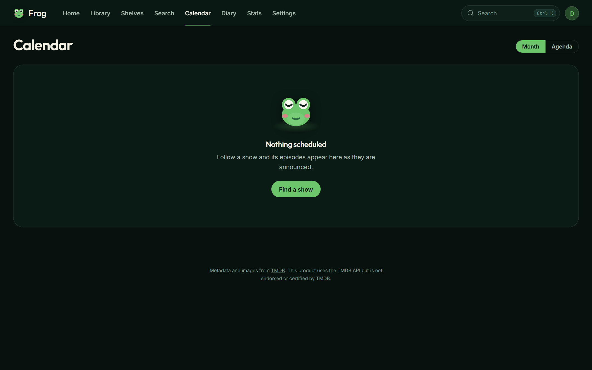

# Frog

### Your own little cinema, on your own little computer.

Frog remembers every film and show you watch, and gives them a beautiful place
to live. Run it for yourself or invite a few people, each with a library of
their own. It costs nothing at all.

[**Get started →**](docs/INSTALL.md)
&nbsp;·&nbsp;
[What's new](RELEASE-NOTES.md)
&nbsp;·&nbsp;
[How it works](ARCHITECTURE.md)

 

---

## What it looks like

<table>
<tr>
<td width="50%">

<b>Your library</b> Every poster, filtered and sorted however you like

</td>
<td width="50%">

<b>A title page</b> Its logo, the scores that matter, and every episode at a glance

</td>
</tr>
<tr>
<td>

<b>Your diary</b> Everything you have watched, day by day

</td>
<td>

<b>Your numbers</b> Years, genres, streaks, and a card to share

</td>
</tr>
<tr>
<td>

<b>Make it yours</b> Your profile, themes, fonts, cards and rows — all live

</td>
<td>

<b>Bring your history</b> Letterboxd, Trakt, IMDb, TV Time and MyAnimeList, with AniList kept in step

</td>
</tr>
<tr>
<td>

<b>Search everything</b> Films, shows, people, characters and studios, with filters to browse by

</td>
<td>

<b>What airs next</b> The month ahead for every show you follow

</td>
</tr>
</table>

### On a phone

&nbsp;&nbsp;

&nbsp;&nbsp;

Add it to your home screen and it behaves like any other app.

  

### Four themes, or build your own

&nbsp;

Pond, Pond Light, Dark and AMOLED — or pick every colour yourself.

---

## A quick tour

**Bring your history with you.** Import from Letterboxd, Trakt, IMDb, TV Time
or MyAnimeList. Frog reads the export, matches each title, shows you what it
found and lets you correct anything it got wrong before a single row is
written. Anime seasons land on the right season, parts and all.

**Bring in AniList.** Connect your AniList account in Settings and your list
arrives in Frog, placed by id, with changes reaching Frog within minutes. Frog
only reads: it never changes anything on your AniList.

**Find anything.** One search for films, shows, people, characters, studios
and the other members of your Frog, each with a tab of its own. Results lead
with the thing you actually meant, a few letters of something you track are
enough, and every studio has a page of what it made. Or leave the name empty
and browse: genre, year, score and what is already in your library sit in a
row of menus under the search bar.

**Scores you can compare.** Every title page shows AniList, IMDb, Rotten
Tomatoes and Metacritic side by side, each with its mark and all as
percentages.

**Watch the trailer, then where to watch it.** Trailers play right on the
title page, and each streaming logo opens that service searching for the
title.

**Tick episodes off.** Every season has a tab, and every episode a card with
a circle on its still. Tap it and the show moves itself to Watching; tick the
last one and it completes itself. Mark a show completed and Frog ticks every
aired episode, asking when you watched them and which specials you saw. Rate
whole seasons once they have finished, and leave a note on any episode.

**Know what is next.** Home opens on whatever you are in the middle of and
names the exact next episode, then everything else you are following, your
shelves and the week's new episodes. The calendar shows the month ahead, and
the diary reads back everything you have watched, day by day.

**Hear about it the day it lands.** Turn on notifications and Frog tells you
when a show you follow has a new episode out. Mute any show with the bell on
its page.

**See your year.** Time watched, streaks, genres, decades, how you rate, and
the actors, directors and studios you watch most — for all time or for any
year. Turn a year into a card you can share from your phone.

**Build shelves.** Hand-pick titles into shelves and drag them into the order
you want, or write a rule and let a shelf fill itself — shows in progress rated
8 or more, say.

**Press Ctrl+K.** Jump to any title, page or setting without reaching for the
mouse.

**Rate it your way.** Out of 100, out of 10, out of 10 with a decimal, five
stars, or three smileys. Switch whenever you like: the number underneath never
changes, so nothing is ever rounded away.

**Make it look how you want.** Four themes plus a colour editor, six fonts,
text size, how much animation, four card styles, poster size, what appears on a
card, and which rows show on Home and in what order.

**Keep spoilers out.** Blur the still for anything you have not watched yet.

**Take it with you.** Install it on your phone. Anything you have already opened
keeps working when you have no signal.

---

## Why Frog?

- **It is yours.** The whole database is one file on your own disk. No account
  on someone else's computer, nothing that can be discontinued.
- **It is free, genuinely.** No subscription, no paid tier, no API that starts
  charging later. The only thing it needs is a free TMDB key; free MDBList and
  fanart.tv keys add scores and logos if you want them.
- **It is quiet.** No ads, no tracking, no analytics, no telemetry, no emails.
- **It is fast.** Everything you have looked at once is cached locally, so most
  pages never touch the network at all.
- **It is one thing.** One small program, one file of data, one page of
  instructions.

## Privacy

Frog assumes everyone on it wants to be left alone, including from each other.

- **Your library is yours.** Ratings, episodes, diary, shelves and settings
  belong to your account. Nobody else on the same Frog can see them, and that
  is enforced on every request, not just hidden in the interface.
- **Invitation only.** There is no sign-up page. An administrator makes a link
  that works once and expires; without one there is no way in.
- **Nothing is public.** Every page needs an account. Frog asks search engines
  not to index it and serves a `robots.txt` that refuses everything.
- **Sharing is something you switch on.** A profile lets others *on your Frog*
  see what you are watching. It starts off, and it is never visible outside.
- Everything sits behind a password, with two-factor sign-in if you want it.
- Nothing leaves the machine except requests for details, artwork and
  scores: to TMDB, to AniList, and to MDBList and fanart.tv if you gave them
  a key. None of them is told who you are, and what comes back is cached so
  most requests happen once.
- There is no analytics of any kind, and no "anonymous usage data".

## Questions

<b>Do I need to know how to program?</b>

 

No, but you do need to be comfortable pasting a few commands into a terminal
once. [The install guide](docs/INSTALL.md) spells out every step, including
getting the free key and reaching it from your phone.

<b>Does my computer have to stay on?</b>

 

Only if you run it on your own machine. Put it on a small server instead and it
is there whenever you are — [the deployment guide](docs/DEPLOY-ORACLE.md) walks
through a free one, where Frog keeps itself up to date on its own.

<b>What if I already track things somewhere else?</b>

 

Import it. Frog reads exports from Letterboxd, Trakt, IMDb, TV Time and
MyAnimeList, and restores its own backups. You see every match before anything
is written. AniList is not imported but connected: Frog keeps reading it from then
on.

<b>Can other people see my library?</b>

 

Only if you let them, and only people who already have an account on the same
Frog. Turn on your profile and they can see your picture, what you are
watching, your pinned titles, your favourites and your totals. It starts switched off, and nothing is ever
visible to anyone without an account.

<b>Where does the artwork come from?</b>

 

[TMDB](https://www.themoviedb.org), a community-built film and television
database, with anime from [AniList](https://anilist.co) and title logos TMDB
lacks from [fanart.tv](https://fanart.tv). Scores from IMDb, Rotten Tomatoes
and Metacritic come through [MDBList](https://mdblist.com). Frog uses their free
APIs and caches whatever it fetches.

<b>What happens to my data if I stop using it?</b>

 

It is a single SQLite file. Copy it somewhere and it will still open in ten
years in anything that reads a database.

<b>Why a frog?</b>

 

It needed a name, and then the name needed a face.

---

### [Get started →](docs/INSTALL.md)

Made by <a href="https://github.com/MihCons">Mihai Constantin</a>
and <a href="https://github.com/zschaeken">Zjef Schaeken</a>. 
This product uses the TMDB API but is not endorsed or certified by TMDB. 
MIT licensed.

