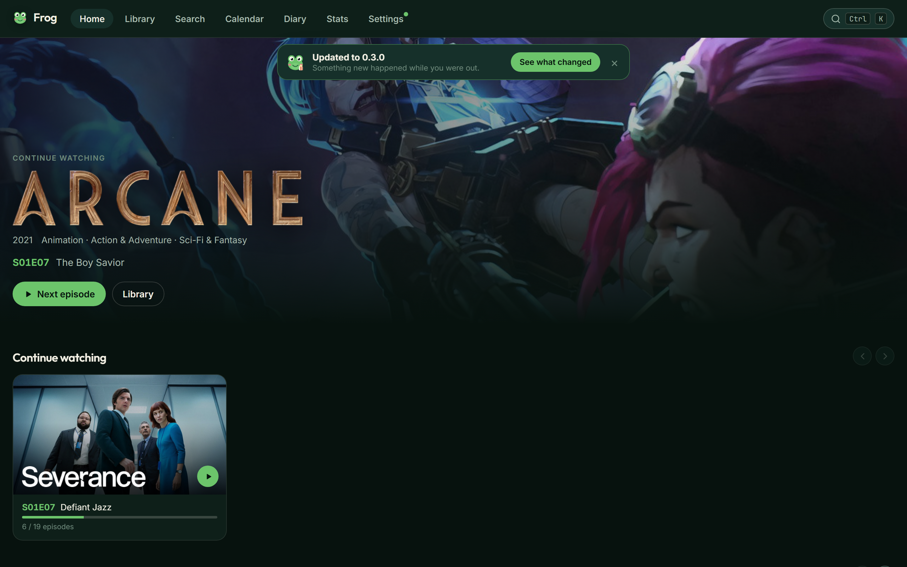
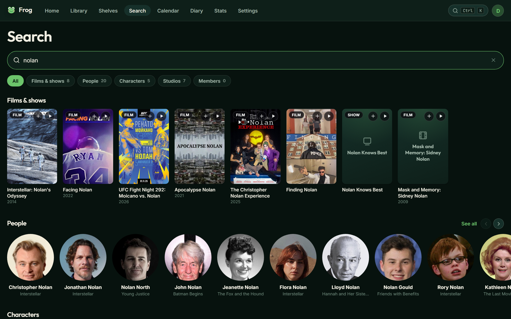
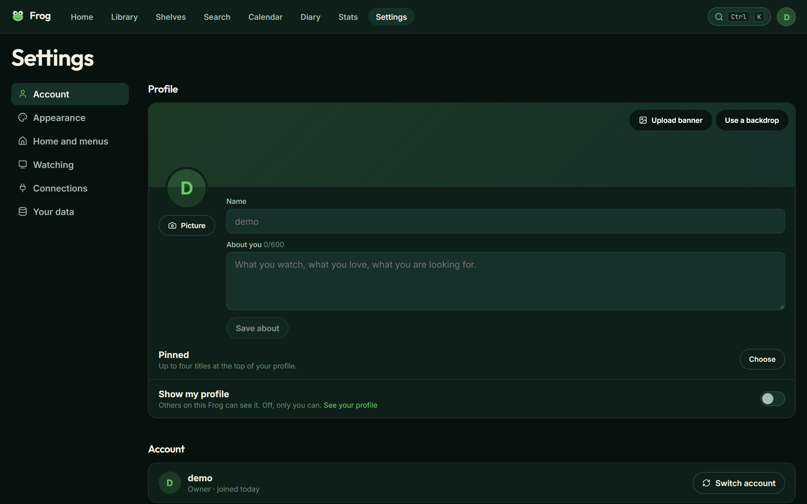

# Release notes

What changed in each release of Frog, written for the people who use it. This
is what the What's new page inside the app shows.

`CHANGELOG.md` is the other one: generated from the commit messages, for
people working on Frog.

This project follows [Keep a Changelog](https://keepachangelog.com/en/1.1.0/) and
[semantic versioning](https://semver.org/spec/v2.0.0.html).

## Upcoming — Spring Peeper —

In progress.

## [1.0.1] — Bullfrog — 2026-10-30

Library filters that stay where you left them, and a Netflix import of what you
really watched.

### Highlights

- **Only what you watched.** A Netflix import leaves out shows you barely
  started. They wait under Barely watched, one tap from coming back, and you
  choose how many episodes count.
- **Filters that stay.** Your library's filters live in the address, so Back
  from a title returns to the same list at the same spot, and a filtered library
  can be shared as a link.

### Improvements

- The number on each status is what choosing it shows, with your other filters
  applied.
- Sorting the library by name starts at A.
- Clear every library filter at once on a computer, as on a phone.
- All five statuses are in view in the filters on a phone.
- Every release on What's new reads the same way.
- Title pages say "Rated 12" rather than a number on its own.
- About carries this release's name, and keeps its technical detail one tap away.
- Settings lists Netflix among its imports, and its rows stay on one line on a
  phone.
- Small controls on a phone are easier to tap, in Search, People and the top bar,
  and the calendar's Month and Agenda.
- Green text is easier to read in the light themes, and Empty my library in
  every theme.

### Fixes

- Back from a title returns to your search.
- A shelf on Home returns to its place when you undo deleting it.

## [1.0.0] — Bullfrog — 2026-10-30

Frog 1.0. A calmer home, a search you can steer, and title pages that put the
show first.

### Highlights

- **A home with one idea per row.** What you are watching leads, with shows
  waiting on their next episode at the end of the same row. Your shelves, the
  week's new episodes and one row of recommendations follow.
- **Search you can steer.** Genre, year, score, your library and sort sit in a
  row of menus under the search bar. Films, shows, people, characters, studios
  and members each have a tab, and the count on every tab is the whole answer.
- **Title pages that put the show first.** One line of facts, the scores that
  matter, and every control in one family. Episodes are cards under a tab for
  each season, with a tick on every still.
- **Scores you can compare.** AniList, IMDb, Rotten Tomatoes and Metacritic,
  each with its mark and all as percentages. TMDB stands in when the others
  have nothing yet.
- **Logos for nearly everything.** Titles TMDB has no logo for get one from
  fanart.tv, and a new season or special borrows the logo of the show it
  belongs to.
- **A diary that reads like one.** A single column down the middle of the
  page, each day once, with the month always in view.

### Improvements

- The bar along the top holds every section, a search field and your account.
- Shelves have covers, and Home offers a new one in a single tap.
- Filters work without a name: pick a genre or a year and browse.
- Shelves, Library, Calendar, Diary, Stats, Import and Administration share
  one page heading.
- Administration lines its sections up in two even columns.
- Dark logos stay readable on dark themes.
- On a phone, search filters open as a sheet along the bottom of the screen.

### Fixes

- A genre only shows have, such as Talk, finds only shows, and one only films
  have finds only films.
- "Not in my library" together with a status finds everything with that
  status, not only what TMDB happens to list first.
- A year filter applies as soon as all four digits are in.
- Home and title pages blend into the page without a line under the artwork.

## [0.8.1] — Toad — 2026-10-30

The notes for Toad, in order, and its name on About.

### Improvements

- What's new sets out everything in Toad as highlights, improvements and fixes.
- About carries this release's name.

## [0.8.0] — Toad — 2026-10-30

A search that finds what you meant, scores from every site on one page, and your
Netflix history on the days you watched it.

### Highlights

- **Search that finds what you meant.** The title you named comes first, and
  films, shows, people, characters and studios each have their own place.
- **Filters.** Combine genre, year, score, sort and what is in your library,
  with a name or on their own.
- **Scores from everywhere.** A title page shows IMDb, Rotten Tomatoes,
  Metacritic, Letterboxd, TMDB, AniList and more side by side, with its age
  rating.
- **Netflix import.** Bring in your viewing activity, or the ZIP from a data
  request. Every show lands on the right season, and every episode and film on
  the day you watched it. Anything unclear is set aside for you to check.
- **Shelves up front.** Your shelves sit at the top of Home, one tap away.
- **People.** Search everyone on your Frog and everyone in film and TV from one
  bar.
- **A calendar that follows what you follow.** Shows you are watching appear,
  and so do premieres on your watchlist. A watchlisted show that is already
  airing waits until you start it. Airing this week and notifications agree.
- **AniList comes in, and nothing goes back.** Your list arrives in Frog within
  minutes, matched with care, with a full page for anything TMDB does not have
  yet. Frog never changes anything on your AniList.
- **Rate seasons.** Every season gets a rating of its own once it has finished
  airing.

### Improvements

- Keep notes on any film or show you track, right on its page.
- Add titles to a hand-picked shelf straight from your library.
- Long imports are quick to review: rows of one show sit together, chips sort
  what needs a look, and close matches can be kept or left out in one go.
- Anime kept from AniList get their title logo where TMDB has one, and studios
  get theirs. Search shows each studio once.
- Title and search pages open faster, and Home and the largest shelf open in a
  moment.
- The library's name filter ignores accents and capitals, so "pokemon" finds
  Pokémon.
- Every control on a phone is large enough to tap comfortably, and secondary
  text is easier to read in every theme.
- Removing your picture or banner, deleting a saved theme and resetting your
  settings can all be undone.
- Unmarking a whole season can be undone, and an undone episode goes back on
  the day you watched it.
- Joining with an invite link looks like signing in.
- Administration shows when each person last signed in, the last backup and
  update, and notifies administrators when one fails.
- Settings is shorter: custom CSS, corner radius, glass blur, grid spacing and
  the settings file are gone.

### Fixes

- Each account on a shared device keeps its own settings.
- Pages that are not there say so, with the way home.
- Up next follows your latest episode rather than the first one you skipped.
- A completed season stays completed when the next one is announced.
- A Frog backup brings back the episodes you watched, one Trakt episode counts
  as one episode, and Letterboxd lists stay out of your library.
- A smart shelf keeps a rating rule such as "at least 8.5" when you edit it.
- The library's status counts stay put while you filter.
- Copies of a saved theme each get a name of their own.
- Renaming a shelf starts with the name ready to type over; Escape cancels.
- Changing the date of a film in the diary talks about the film and starts on
  the day it is filed under.

## [0.7.0] — Treefrog — 2026-10-28

One search for everything, AniList that looks after itself, and trailers that
play.

### Highlights

- **Search everything.** Films and shows, people, characters, studios and the
  members of your Frog, all from one search, each with a tab of its own. A few
  letters of something you track are enough to find it.
- **Studios.** Every studio has a page with what it made, films and shows
  together. The studios on Stats open it.
- **AniList on its own.** Far more of your list lands on the right film, show
  and season by itself, later seasons included, and changes made on AniList
  reach Frog within minutes. Anything left over waits out of the way while
  Frog keeps looking.
- **Finish a show in one go.** Marking a show completed ticks every aired
  episode, asks when you watched them, and lets you pick the specials you saw.
- **Start again.** Empty your library from Settings, Your data, and keep your
  account, settings and devices.
- **Your profile, framed.** Drag your banner to choose which part shows, and
  frame your profile picture in its circle when you add it.

### Improvements

- Trailers play inside Frog, in a row you can scroll, each with the title's
  own artwork.
- Streaming logos open the service itself, already searching for the title.
- A person's page lists each title once with every role, and keeps talk shows
  and award nights in a row of their own.
- Crew shows each person once, with all of their jobs.
- Shows list their whole cast, from every season, wherever the latest season
  lists nobody, as with a lot of anime.
- Three posters across on a phone, in the library and everywhere else.
- Settings that turn something on or off are switches.
- Choosing a date style in Settings changes every date in Frog.
- With Complete automatically off, a show stays as it is when you tick its
  last episode.
- Episodes without a picture of their own show the show's artwork, faded, and
  titles without a poster show a backdrop instead.
- Search leads with titles that have artwork; the few with none at all get a
  card of their own with their name on it.
- Title pages in a poster's colours keep their buttons easy to read in the
  light themes.
- The diary reads as one column on a wide screen.
- Your search stays in the address, so Back returns to your results and a
  search can be shared.
- People is in the More menu on a phone.
- Four new mascots to choose from: Starry-eyed, Bow, Delighted and Sprout.
- Actors, directors and studios sit side by side on Stats.
- Rows with nothing more to show have no scroll arrows.

### Fixes

- The ratings chart on Stats puts every rating under its own score, and
  watch time under an hour reads in minutes.
- Your profile picture sits in front of your banner, and on a phone the banner
  buttons stay clear of it.
- Escape closes the More menu.
- Your name on your profile sits clear of your banner.
- Notices on a narrow window sit above the tab bar.
- If TMDB is briefly out of reach, AniList tries again on its own.
- A sign-in that doesn't match says so in plain words.

## [0.6.0] — Leapfrog — 2026-10-27

AniList and Frog keep each other up to date, profiles become your own, and
Settings is easier to find your way around.

### Highlights

- **AniList, both ways.** Connect your AniList account in Settings and the two
  stay the same: episodes you tick, statuses and scores, whichever side you
  change them on. Every season lands where TMDB numbers it, and anything Frog
  cannot place for certain waits for you to choose.
- **A profile of your own.** A picture, a banner, your name, a few lines about
  you and up to four pinned titles, with your totals, streak and favourite
  genres alongside.
- **Settings, grouped.** Account, Appearance, Home and menus, Watching,
  Connections and Your data, each a tap away on a phone.

### Improvements

- Administrators can delete an account, with a few seconds to take it back.
- Stats and profiles count exactly the titles in your library.
- Finished films and shows brought in without a date count as watched.
- AniList lives in Settings under Connections rather than in Import.

## [0.5.0] — Ribbit — 2026-10-27

Frog is for more than one person now. Everyone gets their own library, and
nobody else can see it.

### Highlights

- **An account each.** Your library, ratings, episodes, diary, notes,
  favourites, shelves, settings and notifications are yours. Nobody else on
  the same Frog can see them or change them, and nothing is visible to anyone
  without an account.
- **Invitations.** There is no sign-up page. An administrator makes a link
  that works once and expires; whoever opens it picks a name and a password.
- **Your account, your devices.** Change your password, turn on two-factor
  sign-in, see every device you are signed in on and sign out of any of them,
  take a copy of everything you have, or delete your account for good.
- **Profiles, if you want one.** Let others on your Frog see what you are
  watching, your favourites and your totals. Off until you turn it on, and
  never visible outside your Frog.
- **Administration.** Invitations, who is here, roles, switching an account
  off, the space Frog uses and when it was last backed up.
- **Keep in step with AniList.** Link a public AniList list in Settings and
  new titles and progress come across whenever Frog opens. Your own ratings,
  pauses and drops stay as you left them.

### Improvements

- The top bar keeps search and your account in reach on every screen size.
- New-episode alerts go out at the hour you chose, read in your own time zone.
- Frog updates itself: new versions arrive on their own, usually within the
  hour.

### Fixes

- Checking for updates and importing from AniList reach the internet again.
- Invitation links open the page for joining, and Administration appears in
  the menu for owners and administrators.
- Each signed-in device has its own clearly named sign-out, so it is obvious
  which one you are ending.

## [0.4.5] — Lily Pad — 2026-10-26

Groundwork for running Frog on a server. Nothing changes on screen.

## [0.4.4] — Lily Pad — 2026-10-26

Groundwork for running Frog on a server. Nothing changes on screen.

## [0.4.3] — Lily Pad — 2026-10-26

New-episode alerts arrive at the hour you picked, in your own time.

### Fixes

- New-episode alerts go out at the hour you chose, read in your own time zone
  rather than the server's.
- Each signed-in device has its own clearly named sign-out, so it is obvious
  which one you are ending.

## [0.4.2] — Lily Pad — 2026-10-26

Your own corner of a shared Frog: your account, your devices, and a profile
when you want one.

### Highlights

- **Your account.** Change your password, see every device you are signed in
  on and sign out of any of them, switch account from the menu at the top
  right, or delete your account.
- **Profiles.** Turn on your profile to let others on your Frog see what you
  are watching, your favourites and your totals. It is off until you turn it
  on, and nobody outside your Frog can see it.
- **Who is here.** Administration lists every account. Change a role, switch
  an account off, and see the space Frog uses and when it was last backed up.

### Improvements

- The top bar keeps search and your account in reach on every screen size.

### Fixes

- Invitation links open the page for joining, and Administration is in the
  menu for owners and administrators.

## [0.4.1] — Lily Pad — 2026-10-26

Frog holds more than one person now, and everybody's library is their own.

### Highlights

- **An account each.** Your library, ratings, episodes, diary, notes,
  favourites, shelves, settings and notifications belong to you. Nobody else
  on the same Frog can see them or change them.
- **Invitations.** There is no sign-up page. An administrator makes a link
  that works once and stops working after that; whoever opens it picks a name
  and a password.
- **Administration.** One page for making invitations, seeing which are still
  open, which were used and by whom, and withdrawing any nobody took.

### Improvements

- About credits the people who make Frog.

### Fixes

- About shows the name of the release you are running.

## [0.4.0] — Lily Pad — 2026-10-26

Your year in numbers, shelves of your own, and a nudge when a new episode is
out.

### Highlights

- **Your stats, in full.** Time watched, streaks, genres, decades, how you
  rate, and the actors, directors and studios you watch most, for all time or
  for any year.
- **Year in review.** A card of your year in film and TV, ready to share from
  your phone or save as an image.
- **New-episode alerts.** Turn on notifications in Settings and Frog tells you
  when a show you follow has a new episode out. Mute any show with the bell on
  its page. Needs Frog opened over HTTPS, such as through Tailscale Serve.
- **Shelves.** Hand-pick titles into shelves and drag them into your own
  order, or make a smart shelf that fills itself, such as shows in progress
  rated 8 or more.
- **Because you watched.** Home suggests titles like the ones you rated
  highest, leaving out anything already in your library.
- **Import from AniList and MyAnimeList.** Enter an AniList username or choose
  a MyAnimeList export. Each season on your list lands on the right season on
  TMDB, parts and long-running seasons included, with the episodes you have
  seen already ticked. Anything Frog is unsure of asks you first.
- **When did you watch this?** Marking a season or a whole show asks: today,
  on release, on a date you pick, or you don't know. Undated episodes count
  towards your progress and stay out of the diary.
- **A tidier diary.** A day of one show is one entry, such as "S04E08–E16 ·
  9 episodes", that opens to show each episode. Change the date of any entry.
- **Two-factor sign-in.** Turn it on in Settings → Security, scan the code
  with any authenticator app, and keep ten recovery codes for a lost phone.
- **Choose your tabs.** On phones, pick four tabs and find the rest under More.
  Reorder or hide pages in Settings → Navigation.

### Improvements

- Import and export live in Settings → Your data, in the Library menu and on
  an empty library.
- Each status has its own colour, everywhere it appears.
- The calendar shows what is on inside each day, with a legend, and the chosen
  day opens beside the month.
- Home's hero reads clearly on light themes and says Start watching for a show
  you have not begun.
- Data saver loads smaller images.
- Calendar and Diary can be your start page.
- Mark a whole show watched from its page.
- Sign-in remembers this device unless you untick Keep me signed in.
- Add any title to a shelf from its page.
- A film you mark as watched appears in your diary and stats.
- Stats and Shelves open offline, like the rest of the app.

### Fixes

- Frog opens and works offline once installed, signed in.
- The command palette's search field sits on one line.
- Season headers fit on narrow phones.
- Every dropdown uses Frog's own menu.
- With nothing in progress, Home's hero shows your newest addition as
  Recently added.

## [0.3.0] — Tadpole — 2026-10-24

Import your library from elsewhere, plan the week ahead, and read back
everything you have watched.

### Highlights

- **Import from Letterboxd, Trakt, IMDb, TV Time and Frog backups.** A guided
  importer reads the export, finds each title on TMDB and shows you the
  matches before anything is written. Anything uncertain is flagged so you can
  choose the right one, and you decide whether the file or your library wins.
- **Export your library.** A full JSON backup or a CSV, from the Import page or
  the command palette.
- **Calendar.** A month view and an agenda of every episode and release you
  follow, with the days you have already watched marked off.
- **Diary.** Everything you have watched, newest first, grouped by month, with
  rewatches and episode ratings in line.
- **About page.** Version, credits and licences in one place.

### Improvements

- Frog ships its own typefaces, so text looks the same on every device.
- Every icon comes from one set, drawn at the same weight throughout.
- Dropdown menus match the rest of the app on every platform.
- Removing a title or unticking an episode offers an Undo.
- The command palette searches your library first, then pages, then actions
  such as Import and Export, and only then the wider TMDB catalogue. Results
  are grouped under headings.
- Home no longer repeats the same show in the hero and the row beneath it.
- A show whose next episode has not aired reads as Caught up, with the date
  the next one arrives.
- Several episodes of one show in the same week appear as a single entry.
- Pages show a skeleton while they load.
- Empty states say what to do next.
- Trailer artwork is drawn locally; nothing is requested from YouTube until
  you press play.
- Search ranks popular titles above obscure ones and labels each result Film
  or Show.
- The episode grid shows TMDB scores underneath your own ratings.
- The mobile tab bar includes Stats.

### Fixes

- Offline mode reports why it is unavailable rather than failing quietly. It
  needs a secure connection, which Tailscale Serve provides.
- Content no longer blanks out while scrolling. Background blur is off by
  default and adjustable in Settings.
- A row holding a single title keeps the normal card size.
- Release notes show complete entries, including keyboard shortcuts.
- The command palette input sits on one line.
- Counts read correctly in the singular.

## [0.2.0] — Ripple — 2026-10-24

A face, a home screen and a great deal to adjust.

### Highlights

- **Frog has a mascot.** A round green face with big eyes and pink cheeks,
  readable down to 16 pixels, used as the app icon and the favicon. Four
  variants to choose from: Classic, Sleepy, Popcorn and 3D glasses.
- **The Pond theme.** Built from the mascot's colours, alongside Pond Light,
  Dark and AMOLED.
- **A home screen.** Separate from the library and opening on whatever you are
  in the middle of, with what to continue, what airs this week and what you
  added recently.
- **A command palette.** Everything within reach on
  <kbd>Ctrl</kbd>+<kbd>K</kbd>.
- **A theme editor.** Live preview, and themes you can save, duplicate, export
  and import.

### Improvements

- Continue watching uses wide artwork with the show logo, the next episode and
  a progress bar.
- Settings are stored on the server, so a phone and a laptop agree.
- Font, text size, corner radius, animation level, card style, poster size,
  grid spacing, card details, hero style, home row order, landing page,
  default status, half stars, date format and custom CSS are all adjustable.
- Spoiler protection blurs stills for episodes you have not watched.
- Search engines are asked not to index the instance.
- Remember this device on the sign-in screen, and sign-in is rate limited.
- A release notes page, with a marker in the navigation after an update.

### Fixes

- The stats page loads.
- Internal faults show a readable message and keep the detail in the log.
- Libraries containing a title you had never watched load correctly.
- Each page sets its own browser tab title.
- Episodes without artwork keep the row layout intact.
- Episodes that have not aired cannot be ticked or rated, and marking a season
  watched skips them.

## [0.1.0] — Spawn — 2026-10-24

The first release.

### Highlights

- **Track films and shows.** Everything on TMDB, with five statuses, ratings,
  favourites and notes.
- **Episode tracking.** One at a time or a season at once, with per-episode
  ratings and notes.
- **Title pages.** Coloured from their own artwork, with cast, crew, seasons,
  trailers, franchise order and where to stream.
- **Install it on a phone.** What you have opened stays available offline.

### Improvements

- Five rating formats, from 100 points to three smileys.
- A library wall with filters, sorting and search.
- Person pages that highlight what you have already seen.
- Runs as a single container, or directly with one script.

[1.0.1]: https://github.com/Frog-Movie-Tv/Frog/releases/tag/v1.0.1
[1.0.0]: https://github.com/Frog-Movie-Tv/Frog/releases/tag/v1.0.0
[0.8.1]: https://github.com/Frog-Movie-Tv/Frog/releases/tag/v0.8.1
[0.8.0]: https://github.com/Frog-Movie-Tv/Frog/releases/tag/v0.8.0
[0.7.0]: https://github.com/Frog-Movie-Tv/Frog/releases/tag/v0.7.0
[0.6.0]: https://github.com/Frog-Movie-Tv/Frog/releases/tag/v0.6.0
[0.5.0]: https://github.com/Frog-Movie-Tv/Frog/releases/tag/v0.5.0
[0.4.5]: https://github.com/Frog-Movie-Tv/Frog/releases/tag/v0.4.5
[0.4.4]: https://github.com/Frog-Movie-Tv/Frog/releases/tag/v0.4.4
[0.4.3]: https://github.com/Frog-Movie-Tv/Frog/releases/tag/v0.4.3
[0.4.2]: https://github.com/Frog-Movie-Tv/Frog/releases/tag/v0.4.2
[0.4.1]: https://github.com/Frog-Movie-Tv/Frog/releases/tag/v0.4.1
[0.4.0]: https://github.com/Frog-Movie-Tv/Frog/releases/tag/v0.4.0
[0.3.0]: https://github.com/Frog-Movie-Tv/Frog/releases/tag/v0.3.0
[0.2.0]: https://github.com/Frog-Movie-Tv/Frog/releases/tag/v0.2.0
[0.1.0]: https://github.com/Frog-Movie-Tv/Frog/releases/tag/v0.1.0
